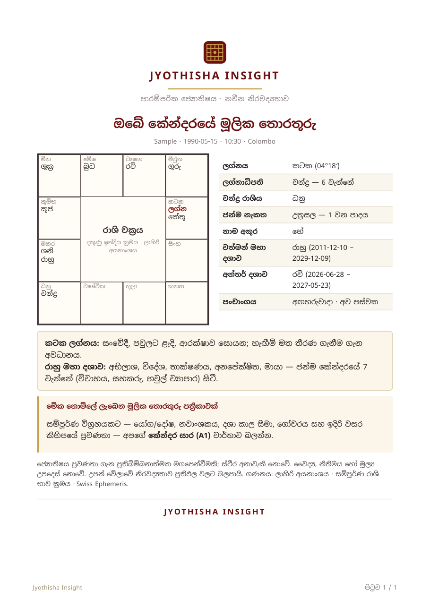
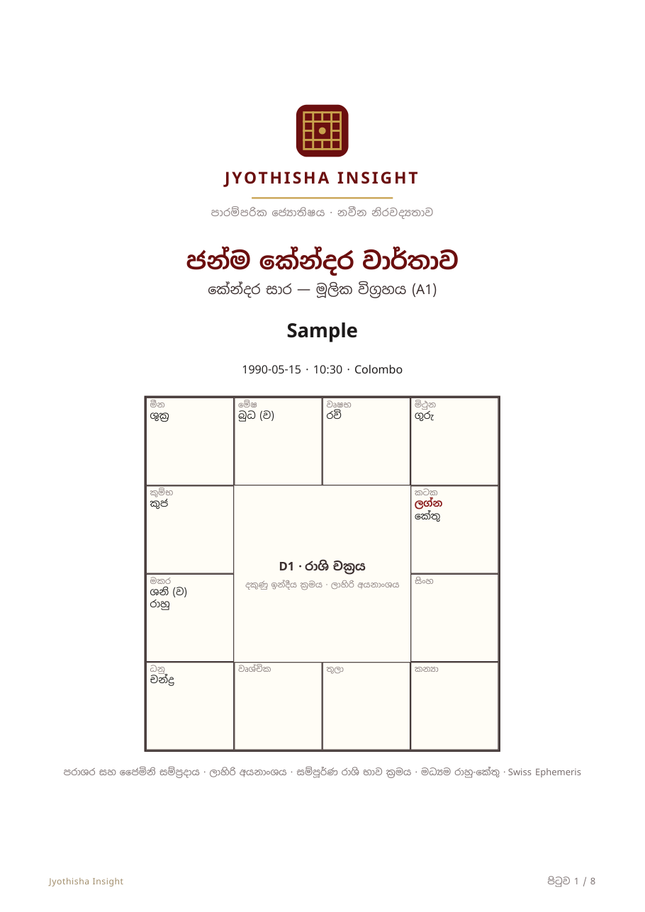
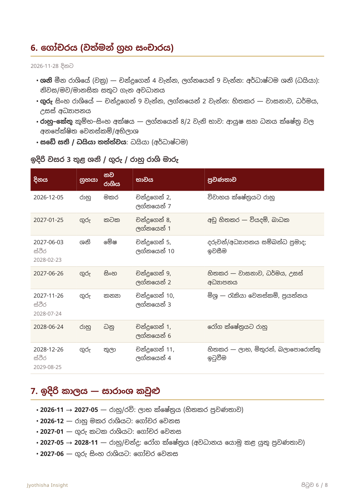
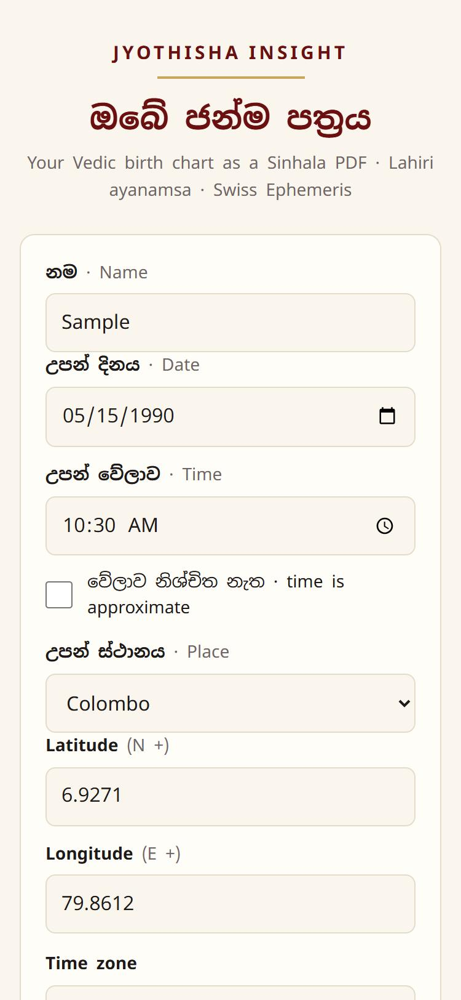

# Jyothisha Insight — Sinhala Vedic Astrology Reports

[](https://github.com/Chamara-Dilshan/astrology/actions/workflows/ci.yml)

**Live demo: [jyotisha-insight.onrender.com](https://jyotisha-insight.onrender.com)**
(free hosting: the first visit after a quiet spell takes up to a minute to wake,
and a report takes 10–30 s)

A command-line pipeline that turns birth data (date, time, place) into a
print-ready **Sinhala** Vedic astrology report (PDF). It calculates the chart
with the Swiss Ephemeris, lays the report out as HTML/CSS and renders it with
WeasyPrint. A built-in visual QA step then checks the rendered Sinhala text.

| Free summary (G) | Natal report (A1), page 1 | A1, transits page |
|---|---|---|
|  |  |  |

Sample PDFs (fictional birth data): [`sample_G.pdf`](docs/samples/sample_G.pdf) ·
[`sample_A1.pdf`](docs/samples/sample_A1.pdf)

## What it does

- **Calculation engine** (`jyotisha_calc.py`): sidereal (Lahiri) planet positions,
  whole-sign houses, divisional charts, Vimshottari / Ashtottari / Yogini /
  Kalachakra dashas, Ashtakavarga, Shadbala, Sripati bhavas, Tajaka annual
  charts, transits, and more.
- **Verified against a textbook:** `--selftest` runs 45 checks against worked
  examples and tables from a Vedic astrology textbook, and Shadbala against
  the worked examples in B.V. Raman's and V.P. Jain's Shadbala books (all
  pass in CI). Planet positions are compared with NASA JPL on the site's
  /accuracy page.
- **Report generator** (`jyotisha_report.py`): 25 report types, including a free
  1-page summary (G, also in English), natal reports (A1–A3, with the Sripati
  bhava chart and Shadbala from A2), annual chart (C1), marriage
  compatibility (D1) and horary (P1). Astrologers can add their own Sinhala
  notes to each section through a JSON file.
- **Visual QA** (`--qa`): measures two rendered Sinhala probe strings (one
  general, one dense in ු/ූ and ්‍ර), renders every page to PNG, and flags
  fallback fonts, overflow and blank pages. Sinhala shaping failures raise no
  error anywhere in the stack, so they have to be measured.

```
web form / CLI ─► jyotisha_calc ─► jyotisha_report (HTML/CSS) ─► WeasyPrint + Pango/HarfBuzz ─► PDF ─► --qa (PyMuPDF)
```

## Quick start with Docker

```bash
docker build -t jyotisha .
docker run --rm jyotisha selftest
docker run --rm -v "$PWD/out:/out" jyotisha report --report A1 --name Sample --date 1990-05-15 \
  --time 10:30 --lat 6.93 --lon 79.85 --place Colombo --out /out/sample_A1.pdf --qa
```

The image bundles Pango/HarfBuzz, the Noto fonts and the ephemeris data, so
there is nothing else to install.

## Web app

```bash
docker run --rm -p 8000:8000 jyotisha        # then open http://localhost:8000
```



A one-page, mobile-first form covering the **whole report catalogue** (25 types in
6 groups, `web/catalog.py`): birth chart, life areas, timing (incl. E1 birth-time
correction), year and month ahead, marriage matching (partner, or 2–5 proposals,
with groom/bride role), and prashna / muhurta. Each report shows only the inputs
it needs (year, month, partners, question, purpose and date range, past events).
Free reports return the PDF; the others build an order message in the browser.
The free G summary can also be made in English (`--lang en`, or the language
choice on the form), for readers who don't read Sinhala.
The place box searches **every town and village in Sri Lanka** as you type
(17,800 places from [GeoNames](https://www.geonames.org), CC BY 4.0, with their
district; English, Sinhala or Tamil names, e.g. `hingu` → Hingurakgoda,
`මහනුවර` → Kandy). Picking one fills in its coordinates, which stay editable; a
place abroad is typed with its coordinates. The search is a POST, so what
visitors type stays out of access logs. Each request runs in a temporary folder
that is deleted afterwards, so no birth data is stored.

The town list `web/places_lk.json` is rebuilt with `python -I tools/build_places.py LK.zip`
(from `https://download.geonames.org/export/dump/LK.zip`); the curated town centres
and Sinhala names in `web/places.json` are merged in and rank first.

Settings, all environment variables:

| Variable | Default | |
|---|---|---|
| `WEB_REPORTS` | `G,A1,A2,A3,N,C3` | reports the site makes for free; every other catalogue report (`web/catalog.py`) is listed with its `prices.json` price and an Order button |
| `ORDER_WHATSAPP` | (none) | WhatsApp number for orders (e.g. `9471…`): the Order button opens WhatsApp with the details filled in. Without it, the details are shown and copied for pasting on Facebook. Order details never reach the server |
| `BRAND_CONTACT` | the Jyothisha Insight Facebook page | contact line printed at the bottom of each PDF (`""` hides it) |
| `ORDER_URL` | the same page | "order a personal reading" button under the form (http/https only; `""` hides it) |
| `REPORTS_PER_HOUR_PER_IP` | 10 | per visitor, sliding one-hour window (HTTP 429 + `Retry-After`) |
| `REPORTS_PER_HOUR` | 120 | for the whole site |
| `SEARCHES_PER_HOUR_PER_IP` | 600 | town searches per visitor (the place box asks as you type) |
| `SEARCHES_PER_HOUR` | 20000 | town searches for the whole site |
| `MAX_PARALLEL` | 2 | reports rendering at once (HTTP 503 when full) |
| `REPORT_TIMEOUT` | 180 | seconds per report |
| `CLIENT_IP_HEADER` | `cf-connecting-ip` | header the proxy sets with the visitor's IP; `X-Forwarded-For` is ignored because clients can forge it |

Only valid requests count towards the limits. They cap CPU use per visitor; they
can't stop traffic from waking a free-tier instance, which is the host's job.

Tests: `pip install -r requirements-dev.txt` then `pytest` (input validation,
what reaches the report, limits, and one real PDF end to end).

<br clear="right">

**Deploy:** `render.yaml` is a [Render](https://render.com) blueprint (Docker,
free plan). In Render choose New → Blueprint and select this repo. Any host
that runs a Dockerfile and sets `PORT` works the same way.

Pushes to `main` deploy automatically only if Render's GitHub app has access to
this repository (GitHub → Settings → Applications → Render → Configure). A public
repo can be deployed by hand without it, so a missing grant fails silently.

## Quick start without Docker (Linux / macOS)

```bash
sudo apt install libpango-1.0-0 libpangoft2-1.0-0 libharfbuzz0b   # macOS: brew install pango
python3 -m venv .venv && . .venv/bin/activate
pip install -r requirements.txt
python3 fetch_ephe.py          # ephemeris data, pinned and SHA-256 checked

python jyotisha_calc.py --selftest
python jyotisha_report.py --report A1 --name Sample --date 1990-05-15 --time 10:30 \
  --lat 6.93 --lon 79.85 --place Colombo --brand "Jyothisha Insight" --out sample_A1.pdf --qa
```

The ephemeris files are optional: without them, the Swiss Ephemeris falls back
to its built-in Moshier model (differences under 1″). Windows setup is in
[RUNBOOK.md](RUNBOOK.md).

## Engineering notes

Problems solved while getting Sinhala rendering right:

- **Silent mis-shaping.** The 2022 GTK3 runtime for Windows ships an old HarfBuzz
  that adds a gap after ූ and the rakaransaya (්‍ර) in Noto Sans Sinhala v3.
  Nothing reports an error. It was found by comparing glyph advances in the PDF
  with a current HarfBuzz (`මූලික`: 3.42 em in the PDF vs 2.72 em expected),
  and fixed by switching to a current Pango/HarfBuzz from MSYS2. The original
  QA probe missed it (about +4 %, inside its 5 % tolerance), so a second probe
  built from the affected letter groups now guards against it.
- **Font URLs on Windows.** `"file://" + "D:\path"` makes the drive letter the
  URL's host, so `@font-face` failed quietly and Pango fell back to a system
  font. The QA font check caught it; the fix is `Path.as_uri()` (`file:///D:/...`).
- **Text encoding on Windows.** Files and console output used the locale code
  page (cp1252), so a client with a Sinhala name crashed the `calc.json` write.
  All text I/O between the two scripts is now explicitly UTF-8.
- **Toolchain gaps.** pyswisseph has no Windows wheels for Python 3.12+, so it is
  built from source with MSVC.

## Stack

Python 3.12+ · FastAPI · Docker · [pyswisseph](https://github.com/astrorigin/pyswisseph) ·
[WeasyPrint](https://weasyprint.org) · Pango/HarfBuzz · [PyMuPDF](https://pymupdf.readthedocs.io) ·
Noto Sans Sinhala (SIL OFL)

## Licence

Code: [AGPL-3.0](LICENSE), the same licence as pyswisseph and the Swiss Ephemeris.
If you run a modified version as a public web service, the AGPL requires you to
offer its source to users; the web app's footer links to the source for this reason.
Fonts in `fonts/`: Noto, [SIL Open Font License 1.1](https://openfontlicense.org).

## Disclaimer

Astrology reports are for reflection and entertainment. They are not medical,
legal or financial advice.
