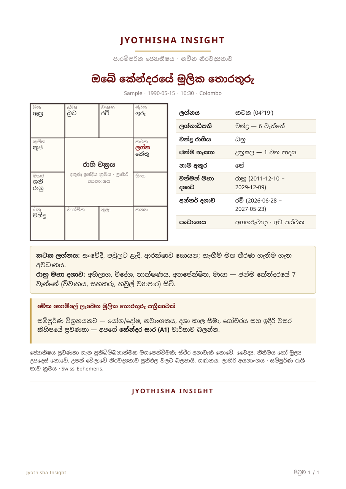
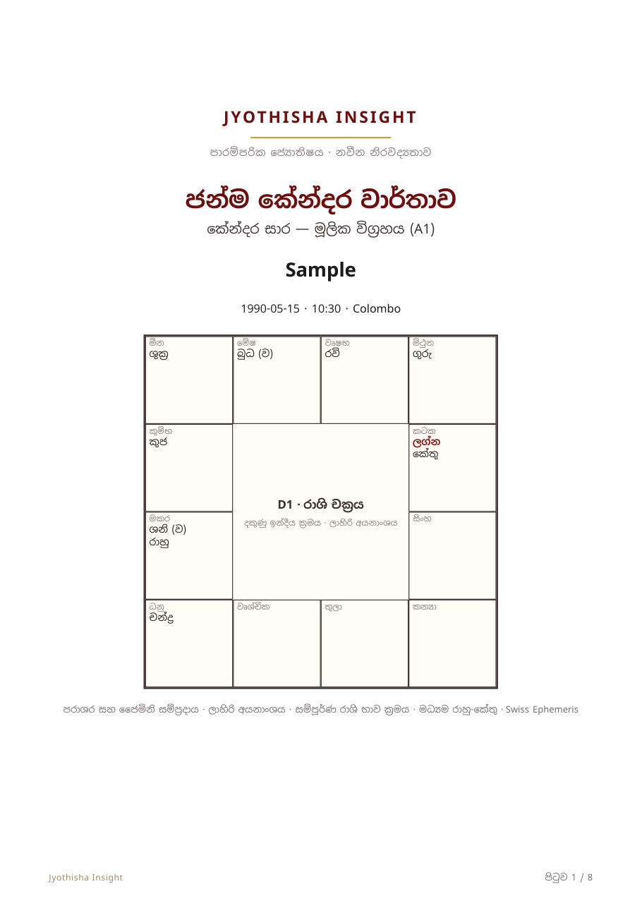
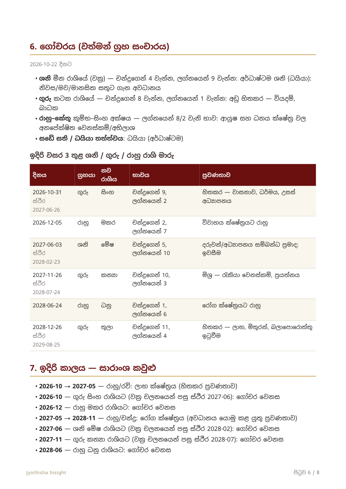

# Jyothisha Insight — Sinhala Vedic Astrology Reports

[](https://github.com/Chamara-Dilshan/astrology/actions/workflows/ci.yml)

A command-line pipeline that turns birth data (date, time, place) into a
print-ready **Sinhala** Vedic astrology report (PDF). It calculates the chart
with the Swiss Ephemeris, lays the report out as HTML/CSS and renders it with
WeasyPrint. A built-in visual QA step then checks the rendered Sinhala text.

| Free summary (G) | Natal report (A1), page 1 | A1, transits page |
|---|---|---|
|  |  |  |

Sample PDFs (fictional birth data): [`sample_G.pdf`](docs/samples/sample_G.pdf) ·
[`sample_A1.pdf`](docs/samples/sample_A1.pdf)

## What it does

- **Calculation engine** (`jyotisha_calc.py`): sidereal (Lahiri) planet positions,
  whole-sign houses, divisional charts, Vimshottari / Ashtottari / Yogini /
  Kalachakra dashas, Ashtakavarga, Tajaka annual charts, transits, and more.
- **Verified against a textbook:** `--selftest` runs 42 checks against worked
  examples and tables from a Vedic astrology textbook (all pass in CI).
- **Report generator** (`jyotisha_report.py`): 25 report types, including a free
  1-page summary (G), natal reports (A1–A3), annual chart (C1), marriage
  compatibility (D1) and horary (P1). Astrologers can add their own Sinhala
  notes to each section through a JSON file.
- **Visual QA** (`--qa`): measures a rendered Sinhala probe string, renders every
  page to PNG, and flags fallback fonts, overflow and blank pages. Sinhala
  shaping failures raise no error anywhere in the stack, so they have to be
  measured.

```
birth data ─► jyotisha_calc ─► jyotisha_report (HTML/CSS) ─► WeasyPrint + Pango/HarfBuzz ─► PDF ─► --qa (PyMuPDF)
```

## Quick start (Linux / macOS)

```bash
sudo apt install libpango-1.0-0 libpangoft2-1.0-0 libharfbuzz0b   # macOS: brew install pango
python3 -m venv .venv && . .venv/bin/activate
pip install -r requirements.txt
mkdir -p ephe && for f in sepl_18 semo_18 seas_18; do
  curl -fsSL -o ephe/$f.se1 https://raw.githubusercontent.com/aloistr/swisseph/master/ephe/$f.se1; done

python jyotisha_calc.py --selftest
python jyotisha_report.py --report A1 --name Sample --date 1990-05-15 --time 10:30 \
  --lat 6.93 --lon 79.85 --place Colombo --brand "Jyothisha Insight" --out sample_A1.pdf --qa
```

The ephemeris files are optional: without them, the Swiss Ephemeris falls back
to its built-in Moshier model (differences under 1″). Windows setup is in
[RUNBOOK.md](RUNBOOK.md).

## Engineering notes

Problems solved while getting Sinhala rendering right:

- **Silent mis-shaping.** The 2022 GTK3 runtime for Windows ships an old HarfBuzz
  that adds a gap after ූ and the rakaransaya (්‍ර) in Noto Sans Sinhala v3.
  Nothing reports an error. It was found by comparing glyph advances in the PDF
  with a current HarfBuzz (`මූලික`: 3.42 em in the PDF vs 2.72 em expected),
  and fixed by switching to a current Pango/HarfBuzz from MSYS2.
- **Font URLs on Windows.** `file://` + `D:\path` makes Python read the drive as
  the URL's host, so `@font-face` fails quietly and Pango falls back to a system
  font. The QA step's font check caught this.
- **Toolchain gaps.** pyswisseph has no Windows wheels for Python 3.12+, so it is
  built from source with MSVC.

## Stack

Python 3.12+ · [pyswisseph](https://github.com/astrorigin/pyswisseph) ·
[WeasyPrint](https://weasyprint.org) · Pango/HarfBuzz · [PyMuPDF](https://pymupdf.readthedocs.io) ·
Noto Sans Sinhala (SIL OFL)

## Licence

Code: [AGPL-3.0](LICENSE), the same licence as pyswisseph and the Swiss Ephemeris.
Fonts in `fonts/`: Noto, [SIL Open Font License 1.1](https://openfontlicense.org).

## Disclaimer

Astrology reports are for reflection and entertainment. They are not medical,
legal or financial advice.
